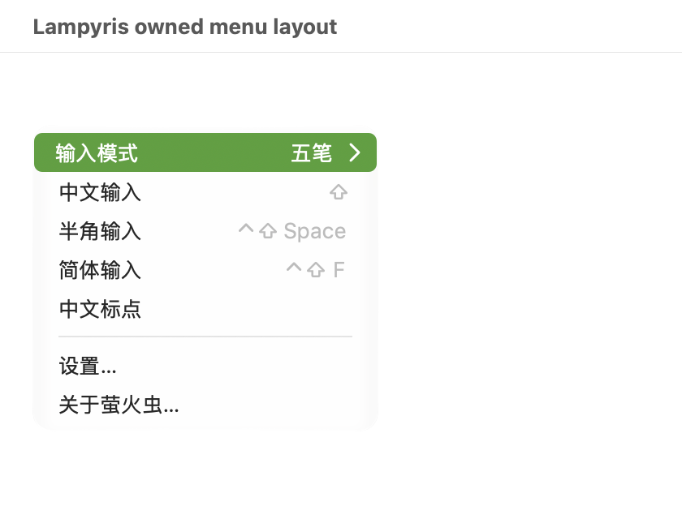
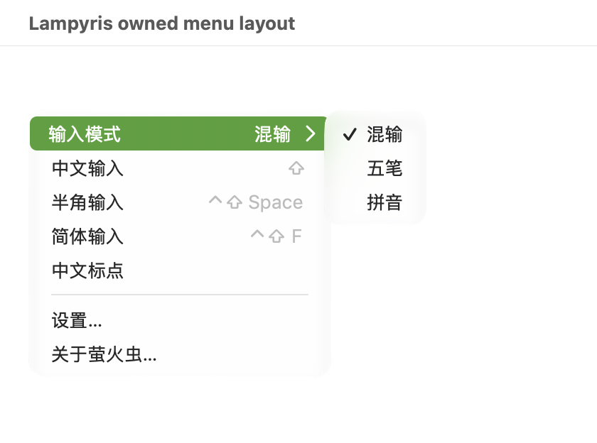
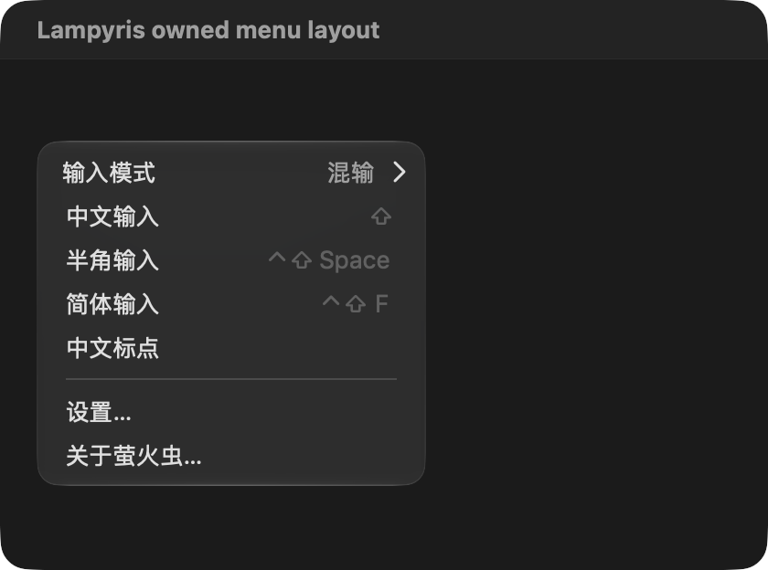

# 033 模式状态普通文字右对齐修正

2026-10-16，续接用户13:42截图反馈；独立工作树codex/menu-state-shortcuts，草稿PR #45。ADR-186先记录/独立提交e65f4fd。未安装，不覆盖主目录已有产品修改。

## 原因与修正

ADR-185设置的富文本制表位在实际原生菜单中没有产生预期位置；旧断言只证明属性赋值，不能证明右对齐。原生keyEquivalent列探针在子菜单项又不显示状态，已撤回，不引入伪快捷键。

改用公开NSMenuItem.view，仅为模式行提供随菜单宽度伸展的绘制；普通菜单字体/语义文字颜色，无标签背景和tooltip。状态文字右边距固定在箭头左侧，保留原生submenu跟踪。鼠标点击和AX按下沿原selector循环且保持菜单；禁用时拒绝。复制菜单时编码模式状态。原生title包含当前模式，以便不支持视图的代理仍有可读回退。

Apple的[菜单视图说明](https://developer.apple.com/library/archive/documentation/Cocoa/Conceptual/MenuList/Articles/ViewsInMenuItems.html)提供view伸展及菜单跟踪机制。自定义行绘制意味着跨进程传递、VoiceOver及macOS13必须继续实机确认，不把隔离窗口成果当作系统输入源验收。

## 实际截图与动作

自有自动退出的AppKit探针直接链接生产InputMenu.swift，独占空白窗口/菜单，无真实配置词库。实际鼠标在自有菜单边界内：父项从混输循环到五笔，菜单保持；原生子菜单悬停展开并点击五笔，CHOSEN wubi。开启菜单时直接AX按下返回true并切换五笔；禁用后返回false、模式保持。三张截图均已查看。

键盘事件探针在修改前335bc84和修改后均未产生模式选择，不能列为键盘导航通过或推断本次新增回归；需正式窗口人工复验。未启动VoiceOver。

原有唯一身份隔离窗口各自close后均确认真实配置/词库摘要保持并清理；最后一实例的AX窗口清单曾为空，保护拦截后改用直接链接生产组件的独有探针，不向其它应用发键。所有探针已退出。

## 验证

- make verify零诊断；117产物隐私扫描通过，无新依赖/联网/配置路径。
- strict universal严格双架构宿主通过。
- 菜单三模式/状态项/失败保持、160/240/360pt几何、无badge/tooltip、菜单复制状态保持通过。
- 真实Rust预览菜单同步回归通过；最终预览重建及完整私有数据冒烟通过。
- 日志：/private/tmp/lampyris-mode-row-{verify-final,universal-final,menu-final,preview-final,smoke-final}.log；完整旧离线26文件85项为前轮证据，本轮仅重跑相关菜单回归，不冒称全矩阵再跑。

已装B仍1621a6d。PR保持草稿；IMK代理视图传递/回退、macOS13、真实VoiceOver与键盘、多屏、A及五工作日仍待，不关闭MVP。
