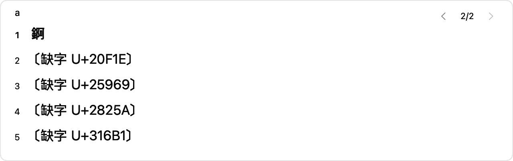

# 034 拼音缺字与教学覆盖专项基线

2026-10-16，用户两张隔离预览截图。ADR-187/188先独立提交fca39bd；独立工作树codex/menu-state-shortcuts，草稿PR #45。已装B仍1621a6d，不安装或覆盖主目录已有代码。

## 拼音a第二页：缺字，不是错误编码

随包D5派生表包含有效Unicode字錒、U+20F1E、U+25969、U+2825A、U+316B1。设备B CoreText对后四字回退LastResort，遍历所有可用字体也无覆盖；原截图方框来自缺少字形。UTF-8及实际候选字符串完整，不能删除有效候选或改写其码点来掩盖。

显示层检测实际CoreText排版回退；缺字字素改为“〔缺字 U+码点〕”，普通汉字/英文/emoji保持。候选及预览摘要共享此表示，tooltip/辅助标签说明选择仍输入原字符。原始候选、排序、分页、点击序号及提交内容均不改；无字体下载或新字体许可/依赖。显示标识不是补齐系统字体，提交到同样缺字体的客户端仍可能出现占位框。

真实FFI加载随包拼音表，a/7项分页复现第二页5字。回归验证每个显示行对应原候选，选择第二项确实返回原U+20F1E而非码点标识；亮暗截图已查看。缺字标识较宽时复用既有自动竖排，不裁掉或重排候选。

## 教学确实需要专项

当前统计：27,823字全码；3,597记录中仅112完整解释，1,348码位字形、2,137部分说明；24,226字只有码。截图wo第二页的握/渥/涡是码位字形，沃/挝是部分说明，肟未有教学记录。不是打开显示开关就能生成这些事实。

| 随包词频优先层 | 完整字数 | 完整比例 | 待补 |
|---|---:|---:|---:|
| 前100字 | 24 | 24.00% | 76 |
| 前500字 | 65 | 13.00% | 435 |
| 前1000字 | 80 | 8.00% | 920 |
| 前3500字 | 92 | 2.63% | 3408 |

核心拼音词表前100/500高频词中，全部组成字有完整解释的只有6/24词。它衡量逐字解释覆盖，不是否认已有词组取码规则。优先层使用随包D10派生最大单字词频、Unicode打破同权；不是用户打字记录，也不是国家常用字表。

已建立[教学覆盖专项卡](../tasks/T-MVP-LEARNING-COVERAGE.md)：先100→500，再1000/3500，每批10–25字按来源/规则核验，阶段各自全部完整才关闭；首版门槛单独评审。专项审计工具只读既有登记数据，报告包含输入SHA和3408项缺口队列；不引入新来源或批量猜写。

## 验证和边界

- make verify零诊断，117产物零网络扫描通过；严格双架构宿主与完整私有预览冒烟通过。
- 候选显示/正常字与emoji/实际FFI分页及罕见字选择通过；亮暗截图已检查。已有完整离线矩阵为前轮证据，本轮重跑相关候选回归。
- 审计两次输出逐字节相同；完整数/记录数/全码数与正式生成报告一致，前3500缺口恰为3500−92。
- 教学数据本轮未增加，仍112完整；C0审计完成不代表C1…C5完成。正式包实际输入、IMK菜单传递、键盘/VoiceOver/A和五工作日仍待。
