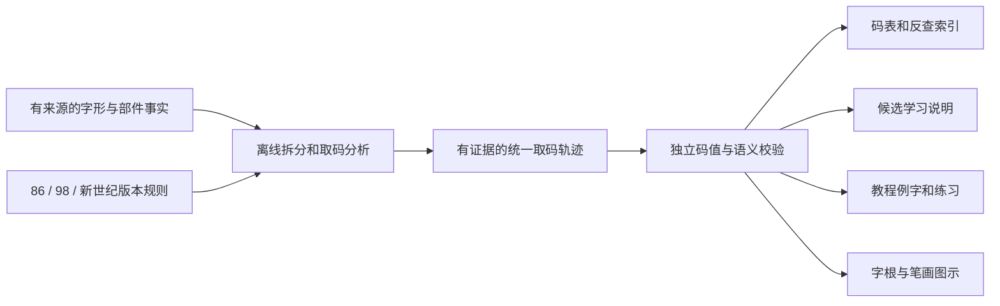

# 036 全量五笔教学生成、多版本扩展与教程复用：方案调研

2026-10-16。状态：**研究建议，待用户确认与数据准入验证，不是已采纳架构**。本轮只读研究、复现统计及文档；未改产品代码、未导入外部教学数据、未实现新五笔引擎或教程。字体保障仍是报告035的独立研究项。

## 1 推荐结论

采用**离线教学数据编译器**：有出处的字符/字形事实与部件关系 → 按版本配置的拆分分析和取码规则 → 有证据的结构化取码轨迹 → 自动生成候选学习说明、查码索引、字根图示和教程例题。逐字说明不再作为主数据手写、分别维护。

结合用户追问“能否自建、不依赖第三方结构数据”，优先建议**项目自建规范结构库＋版本规则包＋离线教学编译器**。项目拥有可独立维护的部件、字形结构、笔顺事实和图示资产；第三方结构数据库不是必需依赖。现有`wubi-encoder`可复用确定性取码规则；`hanzi-chai`仅作为可选的算法参照或可替换的构建工具候选，不绑定其在线API/数据库。数据自建不要求把所有开源工具也从头重写，具体复用仍须独立审查。运行时只读经过验证的静态资源。

**可以不逐字手写说明，不能省去逐字结构事实。** 已有结构事实的字由共享部件和规则生成教学；争议/特殊约定用结构化、可追溯的覆盖项表达。例外比例尚未实测，不预设很少。未取得足够事实时不能用模板、字体或最终编码补出“看似完整”的教学。

## 2 本轮实际做了什么

1. 阅读项目现有生成器、教学模型和编码器；复核D2及D3固定SHA，不改原数据。
2. 读取候选项目固定提交的算法、配置、下载脚本和许可；原始材料仅存临时研究目录，没有执行上游代码或安装依赖。
3. 量化86/98/新世纪候选表的数据形态；区分字数覆盖和教学证据覆盖。
4. 做受限模板投影：不使用现有逐字说明列，以已核验取码单元生成轨迹和短说明，112条全部重建同一全码。
5. 保存[统计证据](../research/teaching-generation-20261016/observations.json)、[来源快照](../research/teaching-generation-20261016/source-manifest.json)和[复现脚本](../research/teaching-generation-20261016/reproduce.py)。两次输出逐字节相同。

未做：全量自动拆分运行、86/98标准全量符合性验证、第三方数据最终准入、字体/资源包体积与性能测量、真实教程教学效果评估。因此下文的技术路线是基于源代码能力和项目约束的推荐，不宣称已生成27,823字完整教学。

## 3 为什么现有输入不能直接全量解释

| 输入/候选 | 实测形态 | 对方案的影响 |
|---|---|---|
| D2，已登记86提示表 | 6,862行；4,444行有PUA，共103种私用字形；长度1/2/3/4分别15/10/859/5,978 | 既不覆盖现有27,823字，也不是完整的笔顺/拆分证据库；不能只补字体就解决 |
| D3，现有primary相关输入 | 27,823行；全部3或4个码位单元（1,930/25,893）；27,822行有PUA，共341种私用字形 | 可以做码值/提示校对，不可默认“4个单元=全部字根”；包含取码、识别或补位信息时需分角色 |
| 新世纪候选：aardio `06.txt` | 6,860物理行，其中6,859行两列；MIT仓库固定提交 | 有格式适配和小范围参照价值，不足以保证全量新世纪教学 |
| 98候选：`Wubi98-Unicode15.1.txt` | UTF-16 BOM，101,729物理行；99,049个唯一非PUA单字符；1,816字有多行；有效单字符行中101,004行注释含PUA | 可评估为98对照/提示输入；重复和PUA必须保留来源，不能“一行一字”或套用86字根意义 |

以上是内容统计，不是对教学准确率的测量。98作者README宣称的99,049字与本轮去重统计吻合，但这不证明拆分、笔顺和解释均正确。

现有`encode_hechengzi`在根数足够时只保留第一、二、三、末根；这是一种有损取码，最终码不能逆推出所有根。现有primary生成中还存在从码位推导字形到键、逆推识别码的自洽路径；不能再用这些推导结果证明相同码值的教学语义独立正确。

## 4 路线比较

| 路线 | 可生成内容 | 多版本/教程复用 | 判断 |
|---|---|---|---|
| 字体/cmap反查、轮廓直接识别 | 字形覆盖或形状候选 | 字体不含五笔规则、规范笔顺；视觉识别还有误差 | 不作为教学事实来源 |
| 最终码表逆解＋套句子 | 已知码位及候选说明 | 信息已丢失，重码/简码/识别码角色不唯一 | 只做码位提示，不能称完整解释 |
| IDS树＋贪心字根匹配 | 一部分结构拆分 | 缺连续笔顺、相连相交、跨部件取根等依据 | 辅助事实/候选生成，不单独定案 |
| 自建结构库＋版本规则＋自有教学编译器 | 自主标注/复核事实后生成全根和取码轨迹 | 共享部件、结构、笔顺和资产，各版独立规则 | **优先建议；初期事实建设成本最高，先做代表性样本验证** |
| 全部从头自研几何拆字器 | 理论上可自主控制 | 几何、笔顺、候选搜索和标准复原工作量大 | 自建数据不等于首步必须重造全部几何工具 |
| 准入的外部结构库＋开源分析＋自有轨迹/规则编译器 | 全根序列、取码理由、识别码、可验证输出 | 按方案版本复用，但事实及资产许可/来源需长期维护 | 备选加速路线；不作为不可替代依赖 |
| 在线/本地模型逐字生成文字 | 自然语言草稿 | 难以保证来源、确定性及与码表一致 | 不作为发布权威数据或运行时依赖 |

这里的维护/适用性判断是设计评估，不是性能基准。无法仅靠上表宣称100%自动正确。

## 5 重点候选与准入边界

### 5.1 hanzi-chai：可替换的构建期分析候选

作者文档描述了基本部件、衍生部件、复合体、笔画顺序以及拆分优先规则。[字库模型](https://docs.chaifen.app/development/data/)、[拆分配置](https://docs.chaifen.app/tutorial/analysis/)、[分析器](https://docs.chaifen.app/development/analyzer/)。这与本项目所需的共享事实层匹配，比仅存四个码位更接近教程需求。

固定提交`00f4f1b9d652b2db0868f30050d7d5608c35334c`中，真正的拆分库位于[packages/hanzi-chai](https://github.com/hanzi-chai/hanzi-chai.github.io/tree/00f4f1b9d652b2db0868f30050d7d5608c35334c/packages/hanzi-chai)。源代码会枚举/评价拆分候选，并按配置的筛选器排序；它提供了保留“为何选择此拆分”的接入点。需要将评价过程转换为项目稳定规则ID，而不是直接把上游类名显示给用户。

作者还提供[现有码表校对流程](https://docs.chaifen.app/tutorial/debug/)，建议先校对基础部件再校对复合字。这支持“修共享部件/规则，批量重算”的维护方式，但作者经验不能替代本项目各版五笔全量验证。

两个重要限制：

- 该项目有自定义分析覆盖路径；找不到真实拆分对应时，会生成占位笔画索引。它可支持上游的编码工作流，但**不能直接作为教程笔画高亮证据**。适配器必须输出`geometry_unverified`状态，而不是伪装成真实笔顺。
- 算法仓库`LICENSE`为GPL-3.0文本；数据由`scripts/fetch.ts`另取`api.chaifen.app/repertoire/all`和`assets.chaifen.app`。已查看的后端仓库`hanzi-chai-data`没有找到明确独立许可授予/固定数据库发布快照。**代码可读不等于数据库已可再分发**；本轮没有获取API全库或准入数据。需要明确数据、SVG/笔顺和各类资产的授权与来源链。

另一个名字相近的[Rust libchai](https://github.com/hanzi-chai/libchai)主要是编码、评测与优化，不是这套字形拆分器。固定`29d01d60e035717fa707b9f068168ffcff945573`的默认features含server及网络服务器依赖；不要因为它使用Rust就直接加到本项目核心crate。即使未来研究使用，也应隔离在构建工具链并审查features/依赖。

### 5.2 其他来源的角色

- **D2/D3/D14**：优先用于兼容性、有限事实及独立对照；不把码位表示升级成无证据的完整结构。
- **98wubi-tables**：固定`6b8b6fb9d3c34e0d5e3b17211e1f1c100e7eb697`根许可为Unlicense，原始文件已做只读统计；具体表、字根字体、图片/PDF的来源仍需分别确认，不能将仓库许可笼统套给所有第三方材料。[作者仓库](https://github.com/yanhuacuo/98wubi-tables)。
- **CJKVI/CHISE、BabelStone IDS**：可补字符结构候选，IDS未必含规范笔顺、拓扑或特定五笔拆法；地区字形也不同。逐文件许可/版本未完成准入。[CJKVI说明](https://github.com/cjkvi/cjkvi-ids)、[BabelStone IDS作者页](https://www.babelstone.co.uk/CJK/IDS.HTML)。
- **Make Me a Hanzi**：可评估为部分常用字结构/笔顺的独立检查来源，不是全量五笔拆分库；[COPYING](https://github.com/skishore/makemeahanzi/blob/master/COPYING)明确dictionary为LGPL-3.0-or-later、graphics为Arphic Public License，不能混成一个MIT来源，也不能因覆盖常用字就推断覆盖本项目全部字符。
- **新世纪其他码表**：如CNMan候选仓库，当前未找到明确许可，不准入；作者公开可见不等于可复制进发布物。

### 5.3 D3许可历史已澄清，需固定采集证据

当前WindInput根许可已是GPL，但提交历史显示2026-10-15更改许可。历史提交`33d1a6c5edef491dc363787fcb53a8c5a581a1c4`的LICENSE是MIT，其D3文件与本项目登记SHA完全一致（`7c64e584…95ac6`）。本轮已逐字读取并校验，不把当前仓库许可误报成原MIT登记失效；未来接入应同时固定采集提交、许可证副本/哈希和实际文件SHA，不能只记录浮动master。现有准入记录本轮未修改。

## 6 推荐模型：共享事实、版本规则、证据轨迹

这是拟议的模型边界，不是已冻结的序列化协议：

| 层 | 核心字段/职责 |
|---|---|
| 字形事实 | `character_id`、地区/字形变体、结构关系、笔顺与稳定stroke_id、可选SVG路径、来源/许可/质量状态 |
| 字根注册表 | 稳定root_id、字形变体/等价关系、独立渲染资产；有Unicode时附加label，PUA只保留原始来源引用 |
| 方案规则包 | `scheme_id`、规范/修订版本、根到键映射、候选拆分优先顺序、取码/识别码/成字根/补位规则、词组和简码规则、结构化特例 |
| 取码轨迹 | 全部根出现位置、选择/略去的根、笔画绑定（有证据时）、规则ID及参数、候选比较理由、识别码依据、全码、与输入/简码的区别、证据引用 |
| 呈现层 | 按规则ID复用中文模板；同一轨迹产生简短提示、详细解释、图示和例题答案，不再逐字另存说明文案 |

同一个字根出现两次，root_id可以相同，但occurrence_id和笔画范围不同；否则“林”等重复部件无法正确标色。86/98/新世纪共用事实，**各自决定字根切分和取码**，不能仅换一张键位表。

一条说明应能由结构化参数生成。例如现有核验记录“好”提供女→V、子→B、末笔横、左右结构，规则轨迹便可生成“女、子取VB；横末笔/左右结构补G，完整码VBG”。这里使用现有已核验事实，不是从VBG反解结构。是否取简码、当前拼音输入串和繁体输出转换应另存，不混进完整码理由。

### 6.1 规则与例外如何维护

- 人写的是少量**规则级模板、部件事实和有来源的方案特例**，不是为每个字写一段解释。
- 普通字符继承部件图和规则；修改共享部件后沿依赖图重算所有受影响字符，并检查差异。
- 特例记录选择哪种已知字形/拆分、哪条规则例外、依据及适用版本；不允许无出处覆盖最终答案来凑覆盖率。
- 每个包固定事实版本、方案版本、分析器版本、渲染模板版本和内容哈希。禁止把86的生成结果直接当作98说明。
- 部分共享、部分版本差异是正常情况。维护成本从“每字×每方案×文案”转为“共享事实＋各版规则/特例＋有限模板”。具体例外比例须实测，不能先承诺接近零。

## 7 全量与教程级完整性必须分开统计

建议首个全量范围固定为当前primary的**27,823字符集合**，随包发布其manifest/hash；这只是本项目86目标，不等于全部Unicode。98和新世纪各自声明范围/Unicode版本与覆盖，不能自动套用本项目86集合或作者“全集”字样。

对每条记录区分：

| 等级 | 含义 | 能否称完整拆字说明 |
|---|---|---|
| E0 | 只有全码/反查 | 否 |
| E1 | 有选中码位及可读根，可能已丢中间根 | 否 |
| E2 | 有完整根序列/明确方案拆分事实，但缺取码理由或识别码依据 | 否 |
| E3 | E2＋有来源的规则、选取/略去步骤、识别码/补位/特例依据，独立校验通过 | 可以称该范围内完整文字说明 |
| G | 另有真实笔画绑定/几何资产，能进行正确高亮/动画 | 独立的图示能力；占位索引不合格 |

**全量文字目标是目标集合100%达到E3；G覆盖单列。** 不能把“缺失提示可显示”算完成，也不应因某字暂缺SVG就把可靠文字说明说成不存在。若源数据不够，产出明确的`missing_fact`、`unknown_legacy_glyph`、`ambiguous_split`、`unverified_override`、`code_mismatch`、`license_blocked`等原因和数量，发布门不会静默跳过。

识别码的末笔/结构必须来自事实和所选版本规则，不从末码反推作为证明。代码相同只说明一个断言成立；还要校验根序/省略关系、结构语义、图形笔画绑定及例外依据。

## 8 教程怎样复用

| 未来用途 | 复用的数据 | 仍需人工设计的内容 |
|---|---|---|
| 候选即时学习 | selected根、键位、识别码、短模板 | 提示密度与交互 |
| 逐步拆字图 | 全根序列、G级stroke绑定、选择/省略步骤 | 图示节奏、可访问说明 |
| 键名字/成字根/识别码章节 | rule_id、概念标签、例字索引 | 章节目标、顺序和教学语言 |
| 为什么不能那样拆 | 真实候选拆分、首个决定性优先规则、评分/事实 | 选哪些错误有教学价值 |
| 分版本教学/对照 | 同字不同profile的轨迹差分 | 用户版本选择及课程范围 |
| 练习题和答案解释 | 经过校验的轨迹和全码/简码；按规则/部件/字频筛样例 | 难度、练习结构与质量审核 |

教程不再重复维护一份字典答案；改正事实或版本规则后，可重建例字、图示和答案。教程章节本身仍需作者设计，不能把自动套模板等同完整教学课程。规则索引和例字索引是离线静态数据，不需要打字统计、用户画像或联网。

字体只解决绘制；非成字字根优先以root_id引用经准入的SVG/轮廓资产。不得把某字体的PUA码位或glyph ID作为跨版本根ID。生成图形仍须继承其源资产许可。

## 9 受限原型结果与不能外推的范围

以现有112条“完整”记录为输入，研究脚本**不使用逐字说明列**，只使用类型、取码单元、键位和现有识别码事实：

- 4种共享模板生成112份简短说明；112次全码重建全部相同。
- 覆盖25键名字、45成字根、37合体记录及5单笔画记录，输出含15种识别码键。
- 能从同一投影按规则家族生成例字索引，说明文案可从主数据中分离。
- 同输入两次生成的统计和投影逐字节相同。

这不是新的自动拆字器，也不是112字全部有教程级笔画图的证明；当前投影缺完整几何、候选拆分竞争和部分特殊约定的独立结构字段。112条原有“完整”标签不自动等价于本报告拟议E3/G审计标准，迁移时还须逐字段校验。**原型验证了呈现/重建这一步，不把结果外推为27,823字已经可生成。**

## 10 建议实施顺序及决策门

这是确认后的建议工作分解，当前未进入产品实施：

1. **B0 自建事实试点与来源边界**：明确首版目标集合和项目自建范围；以现有112字作为抽样起点而非直接改名为自建数据，独立编写/审核基础部件、结构和笔顺记录，并加入难例与86/98差异样例。固定作者、依据、资产来源和版本；统计共享复用率、待决项和实际标注/复核成本。外部资料只对照时不导入发布包；如需复制任何数据库或资产，先完成独立准入。
2. **B1 轨迹原型和差异样例**：拟议schema先写ADR；覆盖键名、成字根、≥4根省略、识别码15格、特殊末笔/结构、同形异地区、重复根和跨部件根；同时选86/98确实不同的案例，验证共用schema而不误共用拆分。明确拒绝占位几何。
3. **B2 86全量影子编译**：对27,823字符逐条产生E等级/G能力、原因码和码值差异；旧primary继续作为运行输入，新增教学输出先影子校对。码值对照和语义检查独立，未审差异不得自动“修正”主码表；完整说明门槛为100%目标集E3。
4. **B3 只读教学包与兼容迁移**：schema/FFI版本化及边界测试后接入现有学习区；未知/不兼容包拒绝且输入保持。小型教学核心与大型可选图形资源分离，常驻输入服务不加载整套教程/字形库。测量体积、加载/RSS和最坏编译资源用量，不虚报估计值。
5. **B4 后续profile**：98先做差异验证，再单独声明全集目标；新世纪缺输入事实/许可时不宣称已支持。新增版本主要提交规则/字根映射/特例及对照测试，必要分析器扩展只在构建侧进行。
6. **B5 未来教程适配**：复用轨迹、概念/例字索引、真实笔画资产，章节与练习策略独立设计；教程产品功能实施前另走用户需求与ADR。

跨阶段门禁：输入/许可/生成版本与SHA清楚；构建不在线抓“最新”；算法在固定数据上确定性运行，候选枚举有界且失败显式；未审差异为零；显示、编码、语义及图示各自统计；核心零网络/零遥测/内存安全约束不变。不能以全码吻合或“程序返回成功”替代教学验收。

## 11 当前可以确认与仍不能确认的事项

可以确认：逐字手写说明不应继续作为主维护方式；统一事实、版本规则和取码轨迹能支撑所需复用；已有算法具备候选拆分/规则评价能力，已有已核验数据能用共享模板生成短说明，方案具备实际技术依据。

尚不能确认：自建27,823字事实库的实际工时、复用率和例外比例；某个外部数据库已满足全量准入；`hanzi-chai`默认配置就是标准五笔86/98；构建/运行时成本；全部图示可用。因此建议用户确认**自建事实库＋版本规则＋统一轨迹**方向后，以B0/B1为首个交付包，通过代表性试点测量成本，再推进全量影子编译。此报告没有采纳生产协议、导入全库、切换码表或重写引擎。

## 12 自建结构数据：可行范围、工作量来源与建议边界

**可以自建，并且不需要把第三方结构数据库作为必需输入。** 需要自主建设的是一份有版本、有审核记录的汉字事实库，而不是另一份逐字说明文本。项目可以控制该库的格式、编辑流程、许可和离线发布；可选开源算法工具与数据库所有权是两个不同选择。

### 12.1 自建内容分层

| 自建层 | 维护什么 | 可自动复用的部分 |
|---|---|---|
| 基础笔画/部件 | 稳定ID、笔画类别、笔顺、相连/相交关系、变体和自绘轮廓 | 同一部件供多个字符、多个方案和图示复用 |
| 复合字结构 | Unicode字符到结构表达式、部件实例、位置变换、局部变形及整字笔顺的对应 | 共享部件更新后重建依赖字符；按字族生成待审核记录 |
| 五笔方案 | 86/98/新世纪字根集合和匹配条件、拆分优先规则、取码与识别码约定、特例 | 同一结构分别生成各版轨迹，检测版本差异 |
| 教学输出 | 少量规则模板、概念标签、例字选择条件 | 自动生成每字说明、反查、图示步骤、例题答案与差异对照 |

笔画事实宜保留点/捺、提/横等细分类别，再由版本规则归并到五笔笔画类，避免在共享层过早丢失信息。部件ID不能直接使用字体私用区码点；字形变体和一次出现的位置也需独立ID。

结构可借鉴IDS的左右/上下/包围表达，但IDS不是一份唯一、规范的五笔拆分答案。Unicode明确允许不同分析和不同深度的描述，不将不同IDS序列自动视为规范等价，也不要求渲染器拼出该字。[Unicode 16第18章，§18.2](https://www.unicode.org/versions/Unicode16.0.0/core-spec/chapter-18/)。本项目仍需自行确认结构、字形变体和各版拆分。

结构树也不能直接当笔顺。例如包围结构存在外框未写完便先写内部、最后封口的交错；简单拼接子部件笔顺会出错。应显式记录整字笔画与部件实例的绑定、书写顺序和连接/交叉关系。普通结构关系可以先支撑文字说明，真实几何和绑定不足时不生成笔画动画或高亮。

### 12.2 哪些能自动化，哪些仍需人工

- **可以自动化**：字段/引用/循环校验、依赖重建、按已知组合规则生成候选记录、字根匹配与版本取码、说明模板、码值差异、图示和练习答案生成。候选结构只能用于有字形依据的已编码目标，不能枚举部件组合后随意赋予Unicode字符。
- **仍需人工建设/审核**：基础部件事实和自绘资产、每字的可靠结构对应、地区/字体变体、异常笔顺、相连相交及跨结构取根、方案约定与争议。自动候选、OCR或模型可以辅助发现，不构成发布证据。
- **无法保证自动推导**：仅凭码点、最终五笔码或字体轮廓获得所有正确结构与笔顺。现有112条模板投影只说明文案可以派生，不验证这项最难的数据建设。

因此，“不逐字手写说明”可实现；“不做任何逐字结构标注/审核就全量正确”当前没有证据。即使多数规则复用，仍至少要为目标字符建立可验证的结构对应，例外规模需要试点测量。自建能减少后续按方案、按呈现形式重复维护，不能消除初期全量事实校核成本。

### 12.3 独立性与来源记录

1. 自主撰写事实记录、自绘部件和笔画资产，记录贡献作者、审核和依据；不把导入第三方表再换字段名称称作自建。
2. 规范、字典和既有码表可作为对照依据；复制其文字、图片、字形轮廓或数据库内容则是另一项准入，按项目许可流程逐项处理。自建不是将第三方字体描摹为SVG后宣称资产原创。
3. 第三方码表可作为可替换的差异检查输入，不能只用“码一致”反证自身结构正确；独立人工核验的样例和规则断言仍需保留。不同对照源冲突时标为待决，不多数表决凑结果。
4. 运行时与重建流程不访问在线API；固定自有数据版本和哈希，工具应能替换。没有外部服务也能编辑、审核、编译和使用已发布教学包。
5. 自建不自动解决候选正文的缺字：部件SVG可保障教学图示，任意罕见整字的显示仍需要对应字形资产/字体，按报告035单独评估。没有必要仅为拆字而先造一套覆盖所有Unicode的字体。

### 12.4 先用试点验证维护成本，再承诺全量

建议确认方向后，首个交付是自建事实模型和代表性小样本，不立即承诺全库完成时间。抽样除了常见左右结构，还应包含键名字、成字根、单笔画、多根省略、包围笔顺交错、相交、重复部件、非成字部件、特殊末笔、地区变体及86/98差异。

应交付：原始结构记录、来源/自创声明、确定性生成器、可读审核视图、文字与几何分别统计、码值和语义差异清单；测量每条新增结构的标注/复核成本、共享部件复用率、自动候选需纠正比例、待决比例和批量修改影响范围，再估算27,823字的建设量。不把本次112条旧数据投影视为这份自建试点已经完成。

最终维护单位是**共享部件事实、每字结构对应、各版规则和例外**；显示文案、查码索引与教程答案全部派生。教程章节和教学顺序仍由人设计，拆字答案不另建第二套库。这比“为每字、每版本、每种界面各写一份说明”更适合作为长期方案；是否采用及试点范围待用户确认。
