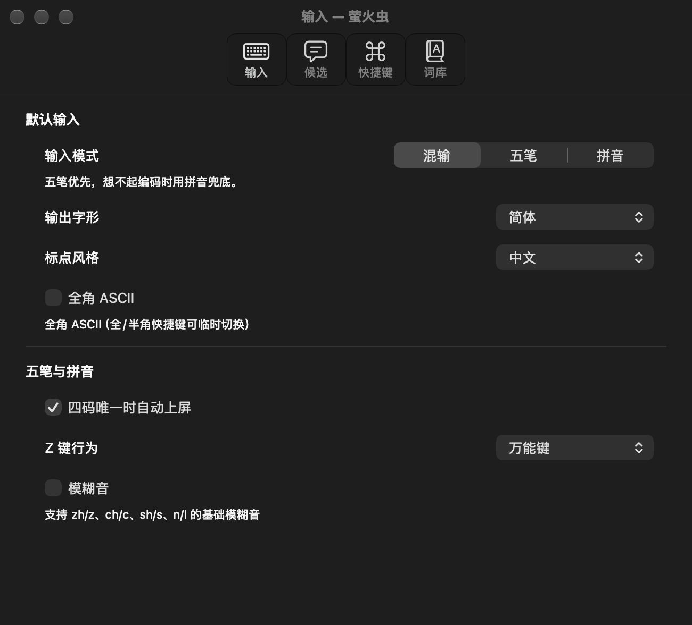
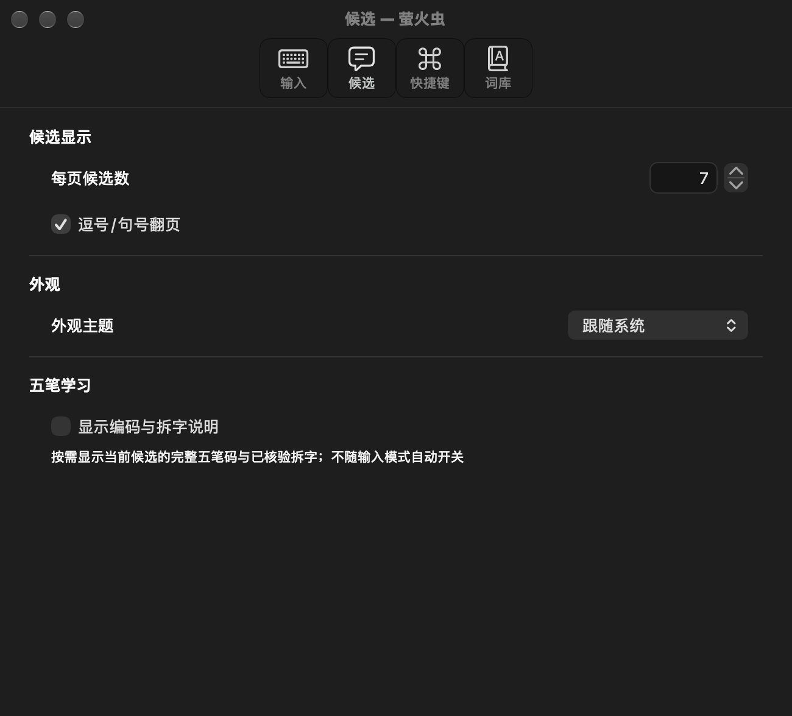
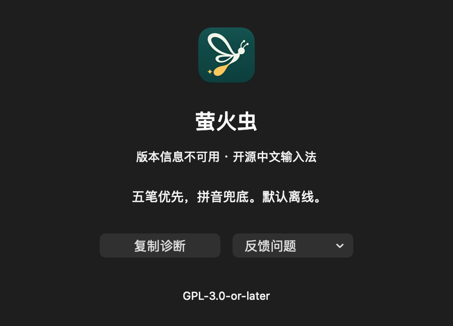

# 039 按钮/菜单标签、系统箭头与设置说明间距

2026-10-16。用户四张截图反馈；ADR-191（e3dff56）先行。独立工作树codex/menu-state-shortcuts，草稿PR #45；不安装、不改主目录既有产品代码。

## 修正

- 系统输入菜单和隔离预览同时将“设置…”改为“设置”、“关于萤火虫…”改为“关于”。关于窗口标题仍是“关于萤火虫”。
- 关于反馈下拉的“反馈问题/报告问题/报告安全漏洞”、打开失败的“重新打开”、设置词库页的新增/删除/导入/导出/反查按钮取消省略号；快捷键按钮保持此前无省略号。进度“正在打开…”是状态提示，保留。全源检查无遗漏的上述动作标签。
- 关于的复制诊断/反馈控件统一regular controlSize、原生rounded bezel及120pt宽度；反馈保留NSPopUpButton下拉渠道。词库按钮显式采用原生rounded/regular样式，启用资格与动作保持。
- 模式行去掉手绘NSBezierPath箭头，使用公开NSImage系统SF Symbol chevron.forward、菜单字体配置、语义前景和等比例绘制。普通模式文字仍右对齐在箭头左侧，父项/子项、标题回退、无badge/tooltip保持。
- 设置标题行以centerY对齐并至少24pt高；标题行到说明的stack间距6pt，统一四个带说明项。该数字是项目布局选择，非HIG硬要求。checkbox/segmented原生控件保留，说明按宽度换行，最小窗继续滚动。

## 原因与可测证据

原先仅将外层spacing设为2pt；checkbox行intrinsic height低于分段控件行，所以相同stack spacing并不代表相同文字距离。新增回归测量实际视图firstBaseline转换到设置行后的差，不只断言spacing常量。

旧版Settings.swift运行同一回归会在description baseline spacing处失败；新布局在亮暗外观下，输入模式、全角ASCII、模糊音、显示编码与拆字说明的标题→说明首行基线均为24pt。[测量JSON](assets/controls-20261016/description-baselines.json)。不以此声称真实VoiceOver或不同系统字体环境已通过。

图片来自原生控件离屏渲染，窗口没有激活；inactive chrome/灰色强调色不等同用户前台窗口。模式高亮由直接调用自有视图的mouseEntered模拟，仅用于绘制检查，没有向桌面发事件或打开真实菜单。箭头探针源码保存在同目录menu-row-probe.swift，可用swiftc同时编译生产InputMenu.swift后传输出目录复现。系统输入源菜单的IMK代理仍需最终包验收。

## 样式依据与验证

按apple-native-product-design技能核对Apple官方[Buttons](https://developer.apple.com/design/human-interface-guidelines/buttons)、[Menus](https://developer.apple.com/design/human-interface-guidelines/menus)及[NSImage系统符号API](https://developer.apple.com/documentation/appkit/nsimage/init(systemsymbolname:accessibilitydescription:))，HIG正文通过官方DocC公开JSON读取。标签取消省略号按用户明确偏好，不称为HIG要求。

- make verify零诊断；117产物隐私扫描通过，无新依赖/网络/配置通道。
- strict universal成功，macOS13部署目标的双架构编译零诊断；开发ad-hoc产物未安装。
- test-input-menu.py：父项循环、原生子项、唯一勾选/状态、宽度、复制、失败保持与IMK字典回调通过。
- test-preview-menu.py：生产菜单组件与真实Rust预览会话/私有配置同步、词库保护通过。
- test-settings-presentation.py：四分区、实际基线、亮暗/最小窗/长错误、Schema/快捷键及私有配置通过。
- test-tools-presentation.py：关于/反馈/词库表单、错误/取消、私有剪贴板与离屏亮暗通过。
- dev-preview.sh --smoke-test：最终预览重建与完整私有数据冒烟通过。没有重跑所有26文件离线矩阵，以上是本轮相关回归。

日志：/private/tmp/lampyris-controls-{verify,universal,settings-final,tools,menu,preview-menu,smoke}.log。B已装仍1621a6d；正式IMK系统箭头/自定义行传递、键盘/VoiceOver、macOS13视觉与报告038剩余门禁继续待验。自建结构库仍MVP后。
